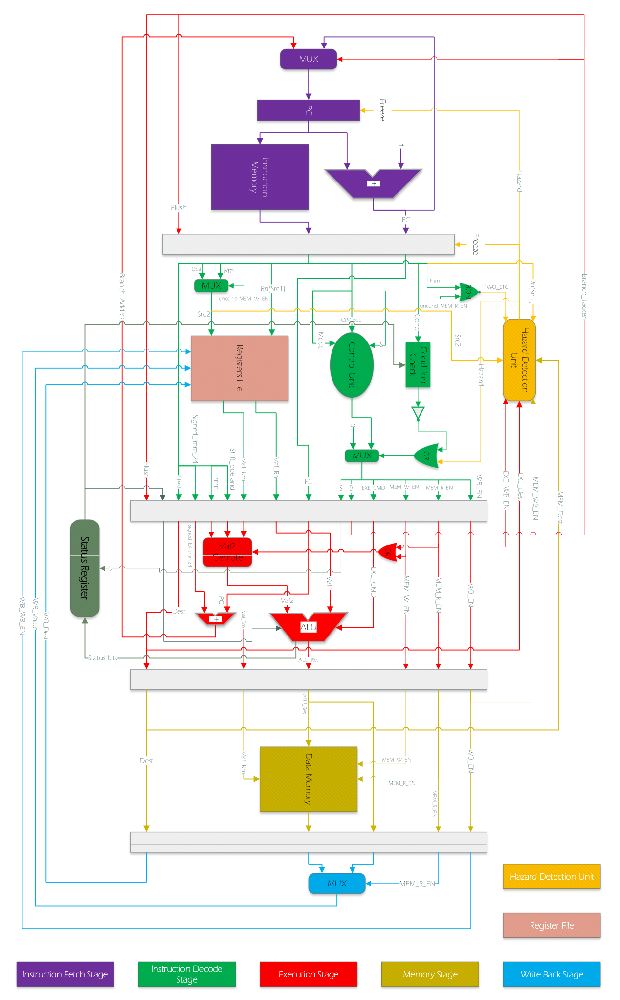
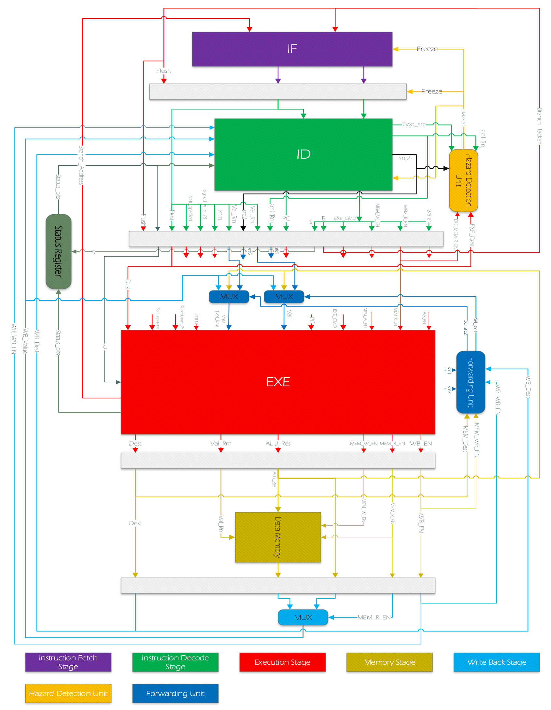
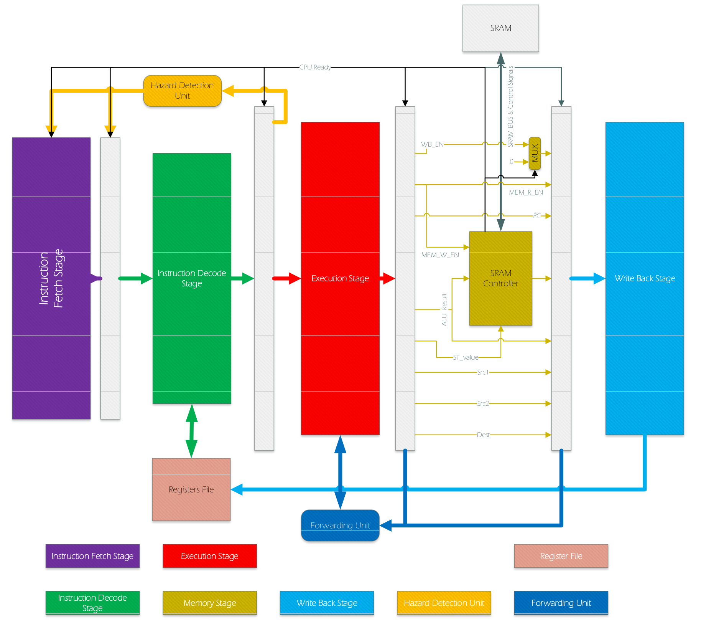

# ARM-Style Pipelined Processor in Verilog

A 32-bit, five-stage processor exploring instruction execution, data dependencies, operand forwarding, and access to an 8-bit SRAM interface. The design progresses from the IF/ID/EXE/MEM/WB datapath to stall-based hazard handling, selectable bypass paths, and a memory controller that serializes word transfers.

The RTL implements a selected ARM-style instruction subset. The original project name, `ARM968E_S`, is retained in the source history; this repository does not establish compatibility with the commercial ARM968E-S core or the complete ARM instruction set.

## Problem and approach

Overlapping instructions creates dependencies between values still in the pipeline and operands needed by younger instructions. Stalling can preserve ordering but introduces bubbles. Forwarding provides an earlier path to those values. A narrow memory interface adds a separate problem: a 32-bit load or store spans several byte transfers, so the processor must hold its state until the memory transaction completes.

The project studies these mechanisms in separate source snapshots. The engineering progression below is based on the available RTL and design specifications. It is not a reconstructed commit history.

## Available phases

| Phase | Engineering change | Available implementation |
| --- | --- | --- |
| 1. Pipeline foundation | Fetch, decode, operand generation, execution, memory access and writeback | Modules retained in later snapshots; no separate early-stage snapshot |
| 2. Hazard handling | Freeze fetch/decode and inject a bubble on RAW dependencies | [`snapshots/hazard`](snapshots/hazard) |
| 3. Forwarding | Select operands from MEM/WB paths and retain load-use stalls | [`snapshots/forwarding`](snapshots/forwarding) |
| 4. SRAM integration | Serialize 32-bit transfers over an 8-bit interface and hold the pipeline | [`snapshots/sram`](snapshots/sram)|

**Evidence status:** archived Vivado outputs are included, but the supplied testbenches have no automatic result checks. No new RTL simulation, synthesis or implementation was run while preparing this repository. Known functional issues are documented below.

## Phase 1: Pipeline foundation

**Goal.** Decompose instruction execution into five stages with explicit pipeline registers and control signals.

`IF_Stage` advances a word-indexed PC and reads a 2048 × 32-bit instruction ROM. `ID_Stage` decodes the instruction, evaluates its condition, reads a 16 × 32-bit register file and produces control signals. `EXE_Stage` generates the second operand, computes the ALU result and forms a branch target. The MEM and WB logic is integrated in `ARM.v`.

The register file and status register update on the falling clock edge; pipeline registers update on the rising edge. Register reset values are their indices, not all zero. The instruction PC increments by one, and branch offsets are added in word units.

| Function | Decode cases present in the RTL |
| --- | --- |
| Data movement | MOV, MVN |
| Arithmetic | ADD, ADC, SUB, SBC |
| Logical operations | AND, ORR, EOR |
| Flag-setting comparisons | CMP, TST |
| Memory and control flow | Selected LDR/STR forms, B, condition checking |

These entries describe implemented decode paths, not verified instruction conformance. The operand generator includes immediate rotation and register shift paths; arithmetic-shift, subtraction/carry and condition-code behavior require correction or directed testing.

**Progress.** This establishes the datapath used by the following phases. Separate IF-only, ID-only and EXE-only source versions were not supplied, so they are not presented as independently tested releases.

## Phase 2: Stall-based hazard handling

**Problem.** A decoded instruction may read a register whose new value is still in EXE or MEM.

The hazard detector compares source indices with pending destination indices and qualifies matches with writeback enables. A detected dependency freezes the PC and IF/ID register while decode emits zero control signals, allowing older instructions to advance. A taken branch redirects fetch and requests pipeline flushing.



*Pipeline architecture with register writeback, dependency detection and branch-control paths. This design diagram describes the intended structure; the RTL remains authoritative.*

**Progress over Phase 1.** Data dependencies are explicitly handled instead of relying on instruction spacing. There is no forwarding unit in this snapshot.

**Available evidence.** The testbench applies reset and allows 10 µs of execution after reset release using a 10 ns clock. Archived implementation data records 4,009 slice LUTs and positive setup slack. It does not establish the correctness of every dependency case.

**Limitation.** `Two_src = ~(uncond_MEM_R_EN | imm)` can omit a store-data dependency for accepted store encodings with instruction bit 25 set. Branch flushing and simultaneous stalls also need directed checks.

## Phase 3: Selectable forwarding

**Problem.** Waiting for register writeback introduces stalls even when an ALU result is already available.

Two three-input multiplexers select each EXE operand from its pipeline value, the MEM ALU result, or the WB value. `forwarding_unit` supplies the selection signals. `FW_EN` switches the hazard detector between broad dependency stalling and load-use detection. The FPGA wrapper exposes `FW_EN` through VIO and observes reset and registers R0–R6 through ILA.



*Operand bypass paths added before EXE, with forwarding selection and load-use hazard detection.*

**Progress over Phase 2.** The hardware adds a way to consume results before register writeback, while maintaining a stall path for loads whose data is not yet available. The testbench runs with forwarding disabled for 10 µs, resets the core, then runs with forwarding enabled for another 10 µs.

**Available evidence.** The archived wrapper uses 4,272 slice LUTs and 3,477 slice registers, compared with 4,009 and 3,226 in the hazard snapshot. These counts include debug IP; they are not an isolated measurement of forwarding logic. No verified cycle-count reduction or speedup is available.

**Limitation.** Selection priority is shared across both source operands. A MEM match on one operand prevents an independent WB match on the other. The store-data pipeline also receives the original `EXE_Val_Rm_i`, rather than the forwarded value. Forwarding is therefore an implemented mechanism with known correctness gaps.

## Phase 4: SRAM integration and memory stalls

**Problem.** The processor transfers 32-bit values, but the memory-side data bus is only 8 bits wide.

`SRAM_Controller` sequences `IDLE`, `BYTE0`, `BYTE1`, `BYTE2`, `BYTE3` and `DONE`. It presents byte addresses and write data, assembles read data and produces `cpu_ready`. When memory is busy, `~cpu_ready` freezes the pipeline registers; fetch and IF/ID also incorporate the dependency hazard signal.

`SRAM_Model`, defined in `SRAM_Simulator.v`, uses `xpm_memory_spram` configured for 2 KiB, an 11-bit byte address, an 8-bit data width and one-cycle read latency. This models the interface using FPGA memory; it is not a demonstrated external SRAM device connection.



*Intended SRAM integration and ready-driven pipeline control. Signal routing in this conceptual diagram must be checked against the selected RTL snapshot.*

**Progress over Phase 3.** A variable-duration memory transaction replaces direct access to a 32-bit data memory. The supplied SRAM testbench keeps forwarding enabled and schedules 50 µs of execution after reset release.

**Available evidence.** The `sram` snapshot has an explicit memory clock connection and archived implementation data at a 33 MHz core clock. Its controller nevertheless truncates the word index to seven bits for the third and fourth bytes, and keeps write activity enabled during an extra state. These defects prevent a claim of correct full-range SRAM operation.

### Alternate SRAM snapshot

The original folder named `ARM968E_S` also contains forwarding and SRAM logic. It is stored as `sram-alternate`, not as the Phase 1 baseline or a proven successor.

Relative to `sram`, it uses nine address bits for all four byte addresses and changes the memory output/enable logic. However, the `SRAM_Model` instance omits `.clk(clk)`, and the memory enable is tied high. Its archived timing has negative setup slack. neither SRAM snapshot is presented as a fully validated release.

## Recorded implementation results

The supplied Vivado 2018.3 artifacts target `xc7z010clg400-1`. Values below describe archived `ARM_Wrapper` implementations, including clock, debug and memory IP. Source-to-build correspondence has not been independently established.

| Snapshot | Core clock (MHz) | Slice LUTs | Slice registers | BRAM tiles | WNS (ns) | TNS (ns) |
| --- | ---: | ---: | ---: | ---: | ---: | ---: |
| Hazard | 33.333 | 4,009 | 3,226 | 6.5 | 0.835 | 0.000 |
| Forwarding | 33.333 | 4,272 | 3,477 | 6.5 | 0.210 | 0.000 |
| SRAM | 33.000 | 3,109 | 3,052 | 7.0 | 0.277 | 0.000 |
| SRAM alternate | 33.333 | 3,187 | 3,323 | 6.5 | -0.173 | -0.173 |

WNS is worst setup slack; TNS is total negative setup slack. The alternate snapshot fails its archived setup timing constraints. Positive slack in the other snapshots does not demonstrate functional correctness, establish maximum frequency or validate the currently packaged source. Differences in memory and debug configurations also prevent direct architectural area comparisons.

The 100 MHz clock used by `ARM_TB` is a behavioral stimulus, not a demonstrated FPGA operating frequency. Machine-readable values are in [implementation.csv](results/implementation.csv), with the supporting [archived outputs](results/archive).

## Repository layout

| Path | Contents |
| --- | --- |
| `snapshots/<name>/rtl/` | Original Verilog and VHDL debouncer source |
| `snapshots/<name>/tb/` | Original `ARM_TB.v` stimulus |
| `snapshots/<name>/ip/` | Vivado XCI configurations |
| `snapshots/<name>/memory/` | Supplied 47-word ROM initialization program |
| `snapshots/<name>/constraints/` | Original board pin assignments |
| `docs/figures/` | Architecture images used above |
| `docs/design/` | Editable Visio diagrams |
| `results/` | Archived evidence, metrics and source hashes |
| `scripts/create_project.tcl` | Vivado project reconstruction helper |
| `scripts/verify_package.py` | Source-integrity and package checks |

Each snapshot keeps its own modules to preserve differences. Do not compile multiple snapshots together: they intentionally reuse module names.

## Recreating a project

Use Vivado with the supplied IP versions, originally generated with 2018.3. The design depends on Distributed Memory Generator, Clocking Wizard, ILA and, for some snapshots, VIO; SRAM variants additionally use XPM memory. No vendor installation or generated IP binaries are bundled.

From the repository root:

```sh
vivado -mode batch -source scripts/create_project.tcl -tclargs forwarding
```

Replace `forwarding` with `hazard`, `sram` or `sram-alternate`. The helper creates `build/<snapshot>/processor.xpr`, copies inputs into that build directory, imports XCI configurations and generates their targets. The helper was prepared from the source structure but has not been executed in Vivado. An existing build directory is rejected to avoid overwriting a previous run.

Open the generated project, select `ARM_TB` for simulation and launch behavioral simulation. Use Run All to reach the supplied `$stop`: 10.040 µs for `hazard`, 20.060 µs for `forwarding`, and 50.040 µs for either SRAM variant. These are scheduled testbench durations, not program completion times. Inspect registers, `hazard`, forwarding selectors, pipeline freeze signals and SRAM bus activity. The supplied stimulus does not produce a pass/fail verdict.

`ARM_Wrapper` is the synthesis top. Review the original constraints for the actual board before implementation; the packaged assignments use clock pin U18 and key pin J15. A newer Vivado release may require IP migration, which should be treated as a separate change.

## Validation scope and next work

Packaging checks verify preserved RTL/testbench bytes and required files. The preparation environment had no Vivado, Icarus Verilog or Verilator, so no new HDL execution results are claimed. Archived elaboration logs demonstrate that a historical simulation snapshot was built; they do not certify the present RTL.

The next verification step is a self-checking regression covering independent MEM/WB forwarding, load-use dependencies, store-data dependencies, signed arithmetic and shifts, branch conditions, and SRAM transactions across the complete address range. Correct the documented defects before making performance or instruction-compatibility claims.

The original RTL is preserved. Only IP coefficient-file paths were relocated during packaging. Diagram provenance is recorded in [figure-sources.md](docs/figure-sources.md).
